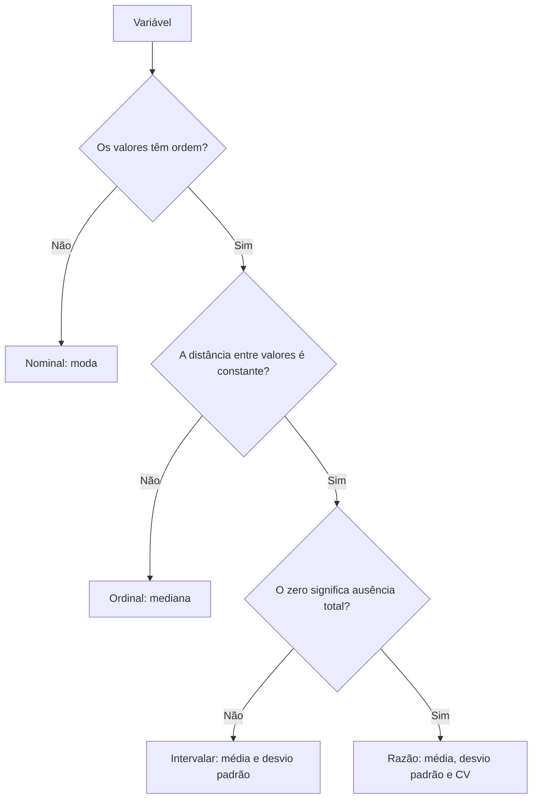

**Código**: STAT101  
**Nível**: Introdutório  
**Pré-requisitos**: Nenhum

## Objetivos de Aprendizagem

Ao final desta matéria, o aluno deverá ser capaz de:

<Steps>

1. Classificar uma variável numa das quatro escalas de mensuração de Stevens (nominal, ordinal, intervalar e razão) e escolher a estatística compatível com ela.

2. Compreender os conceitos de média, mediana e moda e quando utilizar cada um.

3. Calcular e interpretar medidas de dispersão (variância e desvio padrão).

4. Entender a Distribuição Normal e sua importância para o cálculo de estoque de segurança.

5. Identificar outliers em uma série de dados.

6. Compreender **intuitivamente** os conceitos de teste de hipótese (valor-p e hipótese nula) e o que significa "estatisticamente significativo".

</Steps>

## Cobertura no Cronograma

| Módulo | Tópico | Tipo |
| :------ | :---------------------------------------- | :--- |
| [Módulo 2](./cronograma/2026) | Escalas de Mensuração (Stevens) e Tendência Central (Média, Mediana) | Teoria+Prática |
| [Módulo 3](./cronograma/2026) | Dispersão (Desvio Padrão) e Distribuição Normal | Teoria |
| [Módulo 4](./cronograma/2026) | Outliers e Hipótese Nula (Intuição) | Teoria |
| [Módulo 5](./cronograma/2026) | Correlação e Causalidade | Teoria |

## Tópicos Abordados

### Escalas de Mensuração (Stevens, 1946)

Antes de calcular qualquer coisa, pergunte: **o que este número sabe?** O "2" nas costas de uma camisa de futebol e o "2" de uma régua não são o mesmo número. O primeiro só identifica o jogador; o segundo mede uma distância. Em 1946, o psicólogo Stanley Smith Stevens, de Harvard, organizou as variáveis em quatro níveis. Cada nível herda as propriedades do anterior e acrescenta uma nova, e é essa propriedade que autoriza (ou proíbe) cada conta.

| Escala | O que o número informa | Operações válidas | Exemplos na Intendência | Tendência central | Dispersão |
| :----- | :--------------------- | :---------------- | :---------------------- | :---------------- | :-------- |
| **Nominal** | Só identidade: igual ou diferente | `=` `≠`, contagem | Código do item (PN), OM consumidora, quadro (INT, AV, ESP), tipo de gênero | Moda | Frequência e proporção |
| **Ordinal** | Ordem, com distâncias desiguais entre posições | Anteriores e `<` `>` | Posto (Ten → Cap → Maj), classe ABC, prioridade do pedido, escala Likert de questionário | Mediana | Percentis e amplitude interquartil |
| **Intervalar** | Distâncias iguais, mas zero arbitrário | Anteriores e `+` `−` | Temperatura da câmara frigorífica em °C, ano do empenho | Média | Desvio padrão |
| **Razão** | Zero absoluto: proporções fazem sentido | Anteriores e `×` `÷` | Quantidade consumida, lead time em dias, custo em R$, peso em kg | Média | Desvio padrão e CV |

<Callout type="warn" title="Contas que a escala não autoriza">
- **Média de código**: a média dos PN de um almoxarifado é um número sem significado, porque o código só nomeia o item.
- **Posto médio**: a média de "1º Ten = 2" e "Cap = 3" não é "um tenente e meio"; a distância entre postos não é constante.
- **"Duas vezes mais frio"**: a câmara a 2 °C não está duas vezes mais fria que a 4 °C, porque o zero da escala Celsius é convenção, não ausência de calor.
- **CV fora da razão**: o Coeficiente de Variação divide pela média e, por isso, só tem sentido quando o zero é absoluto.
</Callout>

> **Aplicação direta**: a demanda (quantidade consumida) é variável de razão, o que autoriza média, desvio padrão, CV e todo o cálculo de Estoque de Segurança. Já a classe ABC de [DATA201](./data201) é ordinal: é derivada do valor de consumo, mas, uma vez classificada, só informa a ordem de prioridade.

### Medidas de Tendência Central

Onde os dados se concentram — o "centro de gravidade" da série.

- **Média**: Soma dividida pela quantidade. Sensível a valores extremos.
- **Mediana**: Valor central ao ordenar a série. Robusta contra outliers.
- **Quando usar cada uma**: Média para distribuições simétricas; mediana quando há outliers ou distribuição assimétrica (ex.: consumo de peças de reposição rara).

> **Aplicação direta**: ao calcular a demanda média para o Ponto de Reposição, um único mês atípico (operação especial) pode distorcer a média — use a mediana nesses casos.

### Medidas de Dispersão

O quão confiáveis (ou variáveis) são seus dados.

- **Variância**: Média dos quadrados dos desvios. Útil para cálculos internos.
- **Desvio Padrão (σ)**: Raiz da variância. Mesma unidade dos dados — o mais usado na prática.
- **Coeficiente de Variação (CV)**: `σ / Média`. Permite comparar a variabilidade de itens com escalas diferentes.

> **Aplicação direta**: o desvio padrão da demanda é o insumo central do cálculo de Estoque de Segurança em [LOGI201](./logi201).

### Distribuição Normal (Curva de Gauss)

- **Intuição**: A maioria dos fenômenos naturais e de demanda se concentra em torno da média, com ocorrências extremas cada vez mais raras.
- **Regra 68-95-99,7**: ~68% dos valores estão a ±1σ da média; ~95% a ±2σ; ~99,7% a ±3σ.
- **Fator Z**: Multiplicador do desvio padrão para diferentes níveis de serviço (ex.: Z=1,65 para 95%; Z=2,05 para 98%).

<Callout type="info" title="Conexão com Estoque de Segurança">
O Fator Z é o elo entre estatística e logística: `ES = Z × σ_demanda × √Lead Time`. Quem entende a Normal sabe **o que está pagando** ao escolher 95% vs. 99% de nível de serviço.
</Callout>

### Outliers e Hipótese Nula

- **Outlier**: Valor anormalmente distante da média (regra prática: além de ±2σ ou ±3σ).
- **Causas comuns na logística**: Operações especiais, erros de lançamento, sazonalidade não modelada.
- **Hipótese Nula (intuição)**: "Não existe efeito / diferença" — é o estado que queremos refutar com evidência.
- **Valor-p para gestores**: Probabilidade de observar o resultado caso a hipótese nula seja verdadeira. Valor-p < 0,05 → evidência suficiente para rejeitar o "não há diferença".

### Correlação e Causalidade

- **Correlação (r)**: Mede a força e a direção da relação linear entre duas variáveis. Varia de -1 a +1.
- **Correlação ≠ Causalidade**: Sorvete e afogamento são correlacionados (calor causa os dois). Antes de modelar, questione o mecanismo causal.
- **Aplicação em previsão**: Identificar variáveis externas (temperatura, sazonalidade, eventos) que explicam variações da demanda.

## Materiais de Consulta

-   **WHEELAN, Charles. *Estatística: O que é, para que serve, como funciona*.** Zahar, 2016. (Leitura excelente para intuição).
-   **ANDERSON, David R. et al. *Estatística Aplicada a Administração e Economia*.** Cengage, 2019. (Livro texto base).
-   Dataset de exemplo: Dados simulados de consumo de gêneros alimentícios.

## Avaliação

### Exercícios Práticos

<Steps>

1. Classificar as colunas de uma planilha de consumo do rancho (OM, data, gênero, classe ABC, temperatura de armazenagem, quantidade em kg, custo em R$) nas escalas de Stevens e indicar a medida de tendência central adequada a cada uma.

2. Calcular média e mediana de uma série com outlier e comparar o impacto em cada medida.

3. Dado um desvio padrão e um nível de serviço, encontrar o fator Z e calcular o Estoque de Segurança.

4. Classificar um outlier em uma série de demanda e propor tratamento (exclusão ou substituição pela mediana).

5. Interpretar o coeficiente de correlação entre temperatura e consumo de um insumo.

</Steps>
